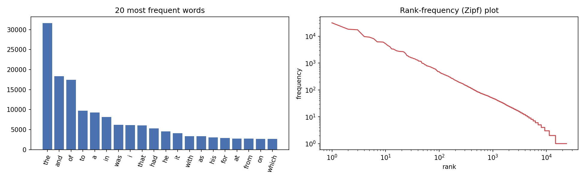
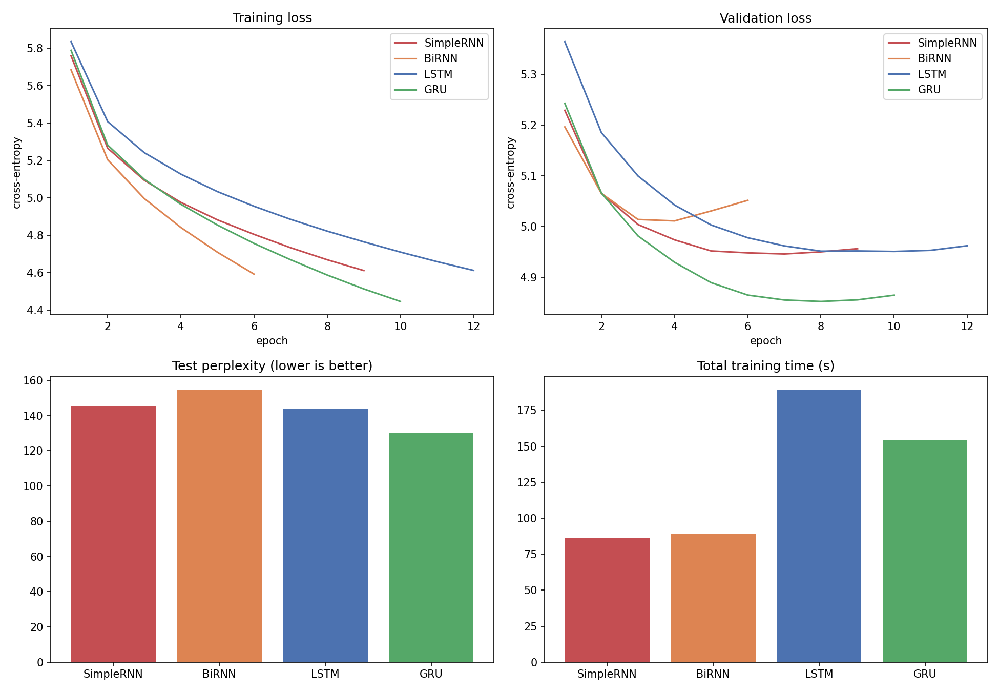
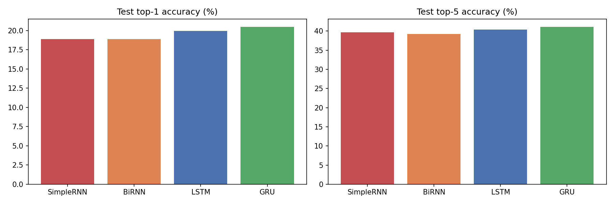
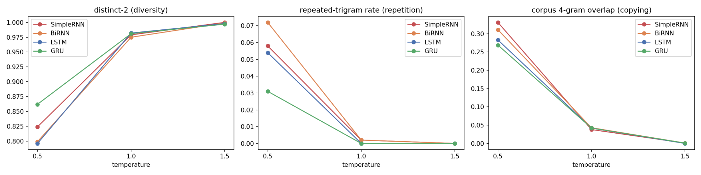

# Autoregressive Text Generation on H. P. Lovecraft's Fiction

**Course:** Foundations of Generative AI (ICT4403) — Assignment 2  
**Student:** Apratim Sharma  
**Registration number:** 230911390

## 1. Objective

This project implements and compares four recurrent neural network architectures for next-token prediction and autoregressive text generation: SimpleRNN, Bidirectional SimpleRNN (BiRNN), LSTM, and GRU. Models are compared using held-out test loss, perplexity, top-1 and top-5 accuracy, training time, and generated-text metrics. Text is sampled from the same three seed contexts at temperatures 0.5, 1.0, and 1.5.

## 2. Dataset and source

- **Dataset:** *The Complete Works of H. P. Lovecraft*.
- **Source page:** [Internet Archive collection](https://archive.org/details/TheCompleteWorksOfHPLovecraft_201412).
- **Text file used by the notebook:** `The Complete Works of H.P. Lovecraft_djvu.txt`, downloaded from the Internet Archive item.
- The raw corpus is downloaded at runtime and is not redistributed in this repository. Check the source collection's rights and reuse notes before redistributing the corpus.

The corpus is a single-author collection with distinctive vocabulary and long sentences, making it useful for comparing local phrase learning, repetition, and stylistic drift.

### Preprocessing and sequence construction

The notebook trims front matter, lowercases text, folds accented characters to ASCII, rejoins words split by line breaks, removes standalone page numbers and lines containing URLs, tokenizes words/apostrophes plus selected punctuation, and collapses repeated punctuation. The stream is split chronologically into train/validation/test partitions (80%/10%/10%) before windowing. The vocabulary is built from the training partition only; the 6,000 most frequent tokens are retained and other tokens map to `<unk>`. Each example contains 20 context tokens (including punctuation tokens) and predicts the following token with a stride of one.

## 3. Architectures and training configuration

Each model uses an embedding dimension of 128, 128 recurrent units (per direction for BiRNN), dropout of 0.3, and a dense softmax output. Training uses Adam with learning rate 0.001, gradient clipping at 1.0, batch size 256, sparse categorical cross-entropy, a fixed random seed, early stopping on validation loss with patience 2, and a maximum of 15 epochs.

| Model | Recurrent layer |
|---|---|
| SimpleRNN | `SimpleRNN(128)` |
| BiRNN | `Bidirectional(SimpleRNN(128))` over the known context window |
| LSTM | `LSTM(128)` |
| GRU | `GRU(128)` |

The bidirectional model reads the already-observed context in both directions; it does not receive future target tokens as input. Its output representation and parameter count are larger than the unidirectional models.

## 4. Dataset statistics

| Statistic | Value |
|---|---:|
| Total tokens (words + punctuation) | 506,674 |
| Word tokens | 461,038 |
| Unique words | 23,756 |
| Type-token ratio | 0.0515 |
| Words occurring once (hapax) | 8,944 |
| Mean sentence length | 25.2 words |
| Median sentence length | 24 words |
| Vocabulary size used by models | 6,000 |
| Train / validation / test sequences | 405,319 / 50,647 / 50,648 |
| Unigram-baseline perplexity | 393.8 |



## 5. Quantitative results

The table below reproduces the saved experiment summary in `outputs/model_comparison.csv`.

| Model | Parameters | Test loss | Test perplexity ↓ | Top-1 accuracy | Top-5 accuracy | Epochs | Best epoch | Training time |
|---|---:|---:|---:|---:|---:|---:|---:|---:|
| SimpleRNN | 1,574,896 | 4.9804 | 145.54 | 18.91% | 39.65% | 9 | 7 | 86.1 s |
| BiRNN | 2,375,792 | 5.0398 | 154.44 | 18.90% | 39.21% | 6 | 4 | 89.2 s |
| LSTM | 1,673,584 | 4.9675 | 143.67 | 19.94% | 40.39% | 12 | 10 | 189.0 s |
| **GRU** | **1,641,072** | **4.8698** | **130.29** | **20.48%** | **41.07%** | **10** | **8** | **154.6 s** |





**Interpretation:** In this saved run, GRU has the lowest test loss/perplexity and the highest top-1 and top-5 accuracy. SimpleRNN has the shortest recorded training time; LSTM has the longest. These are results from one run per model, so small differences should be treated as observations rather than statistically significant conclusions.

## 6. Temperature analysis and generated text

The same three seed contexts were used at temperatures 0.5, 1.0, and 1.5. Each generated sample contains 80 generated tokens; punctuation is tokenized separately. The full samples are in [`outputs/generated_samples.md`](outputs/generated_samples.md), and the metrics are in [`outputs/generation_metrics.csv`](outputs/generation_metrics.csv).



- **Temperature 0.5:** the distribution is sharper. The saved metrics show lower distinct-1/distinct-2 and higher repeated-trigram rates and corpus 4-gram overlap, indicating more repetition and reuse of familiar phrases.
- **Temperature 1.0:** lexical diversity rises and repeated-trigram rates are close to zero in the saved samples. This is a reasonable balance in the recorded experiment, though grammar and contextual consistency remain imperfect.
- **Temperature 1.5:** distinctness is high and corpus 4-gram overlap is almost zero. This indicates novelty, not necessarily coherence; the examples often contain awkward word combinations and semantic drift.

The seed-topic-retention metric measures overlap between generated tokens and content words from the **last 20 tokens of each seed context**. It is only a rough proxy for topic retention and should be interpreted alongside manual inspection.

## 7. Qualitative assessment and conclusion

All four models learn some vocabulary and atmosphere from the corpus, but none reliably maintains a coherent narrative over long generations. Lower temperature tends to repeat familiar phrases; higher temperature increases lexical variety but also increases abrupt transitions and contextual drift.

**GRU is the strongest overall model in this saved experiment** based on the quantitative test metrics: top-1 accuracy 20.48%, top-5 accuracy 41.07%, and perplexity 130.29. SimpleRNN is preferable if the priority is shortest training time. A temperature around 1.0 is a reasonable starting point for GRU generation, but the samples still have notable limitations.

## 8. Limitations

- Word/token-level next-token models learn local patterns better than long-range narrative structure.
- The 6,000-token vocabulary maps rare words to `<unk>`.
- Results are from one run per model; repeated runs would be needed to estimate variability.
- Diversity and n-gram overlap do not directly measure semantic coherence.
- Training times depend on runtime hardware and should not be expected to reproduce exactly.
- The notebook is uploaded without embedded execution outputs. The `outputs/` directory contains artifacts from the previously completed run; rerunning the notebook regenerates them.

## 9. Repository contents

```text
.
├── Lovecraft_Autoregressive_TextGen.ipynb
├── requirements.txt
├── README.md
└── outputs/
    ├── dataset_stats.csv
    ├── dataset_characteristics.png
    ├── model_comparison.csv
    ├── histories.json
    ├── training_comparison.png
    ├── accuracy_comparison.png
    ├── generation_metrics.csv
    ├── temperature_effects.png
    ├── generated_samples.md
    └── results_summary.md
```

## 10. How to run

### Google Colab (recommended)

1. Open Google Colab and upload `Lovecraft_Autoregressive_TextGen.ipynb`.
2. If available, select **Runtime → Change runtime type → GPU**.
3. Run all cells in order. The notebook downloads the text, preprocesses it, trains the four models, evaluates them, and regenerates the output files.
4. Training time and small metric differences may vary by runtime environment.

### Local execution

Use Python 3.10+ and an environment that supports the TensorFlow version in `requirements.txt`. Internet access is required for the dataset download.

```bash
python -m venv .venv
# macOS/Linux
source .venv/bin/activate
# Windows PowerShell
# .venv\\Scripts\\Activate.ps1
pip install -r requirements.txt
jupyter notebook Lovecraft_Autoregressive_TextGen.ipynb
```

## 11. Dataset source link

https://archive.org/details/TheCompleteWorksOfHPLovecraft_201412
